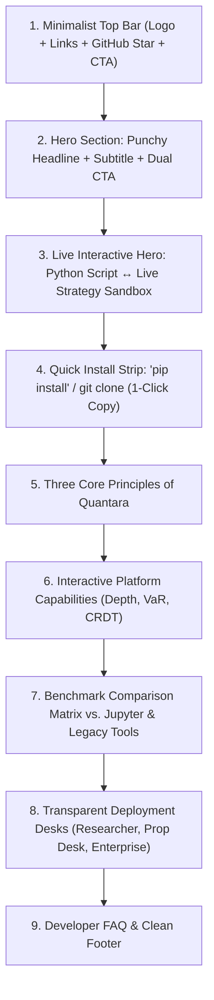

# Quantara Landing Page Redesign Plan
*A human-crafted, developer-first visual identity inspired by Streamlit.io*

---

## 1. Executive Summary & Problem Diagnosis

### Why the Previous Design Looked "AI-Generated"
The previous landing page suffered from the standard tropes of synthetic, automated web design:
1. **Murky Gradient Soup:** Dark navy-to-purple background (`#070b14`) with generic cyan/violet blur orbs that feel like a cookie-cutter Web3 template.
2. **Repetitive Card Grids:** Symmetrical 3x2 grid of cards with identical glowing 1px borders, generic icons inside square boxes, and low-contrast grey text (`#94a3b8`).
3. **Corporate Buzzword Overload:** Abstract, passive phrasing ("Harmonizing synergetic state-space paradigms") instead of tangible, punchy developer benefits.
4. **Static "Faux" Product Demos:** Abstract SVGs pretending to be charts rather than tactile, interactive tools that users can manipulate.

---

## 2. Visual Direction & Design Language (The Streamlit Benchmark)

Streamlit's landing page succeeds because it feels **tactile, confident, honest, and energetic**. It treats Python developers with respect: clean whites and charcoals, signature punchy coral red (`#FF4B4B`), warm accent yellows and mint greens, generous whitespace, and a side-by-side "Code $\rightarrow$ Live App" interactive story.

### The New Design System Tokens for Quantara

| Token Category | New Design Specification | Purpose & Rationale |
| :--- | :--- | :--- |
| **Canvas & Surfaces** | **Crisp Studio Theme:** Pure White (`#FFFFFF`) and Warm Slate Canvas (`#F9FAFB`, `#F3F4F6`), with contrasting Charcoal Code Windows (`#1E1E24`). | High readability, institutional credibility, clean editorial breathing room. |
| **Primary Brand Accent** | **Signature Coral-Crimson (`#FF4B4B` / `#E11D48`)** paired with **Warm Amber (`#F59E0B`)** and **Alpha Green (`#10B981`)**. | High-energy, memorable, developer-beloved (inspired by Streamlit's signature punch). |
| **Typography** | **Headline:** Bold, geometric sans (`Inter Display` / system sans at 56px–72px, `-0.03em` tracking, high contrast `#111827`).<br>**Code:** Monospace (`JetBrains Mono`, `Fira Code`) with authentic Python syntax highlights.<br>**Body:** Crisp Dark Slate (`#374151`, line-height 1.65, 16px–18px). | Immediate legibility, human editorial feel, eliminates eye-straining washed-out grey text. |
| **Tactile Elements** | Subtle marker underlines, clean pill tags with crisp 1px borders, real interactive sliders and toggles, genuine tab switchers. | Eliminates generic neon glow blur. Every element feels clickable and physical. |

---

## 3. Narrative Architecture & Section Blueprint

Following Streamlit's proven **"Principles"** narrative model:



---

### Section 1: Minimalist Navigation Header
- **Left:** Quantara emblem (clean modern mark) + bold wordmark.
- **Center:** 4 clean text links: *Principles*, *Live Demo*, *Architecture*, *Desks*.
- **Right:** 
  - GitHub link with star count badge (`koiic/quantara`)
  - "Quick Demo" button (1-click guest login)
  - Bold primary CTA: **"Launch Hub"** (Coral Red `#FF4B4B`, rounded-md, no neon gradients)

---

### Section 2: High-Impact Hero
- **Headline:** 
  > **A faster way to research, backtest, and stage quantitative trading strategies.**
- **Subheadline:**
  > Turn your quantitative ideas into venue-calibrated execution algorithms in minutes. All in pure Python. No fragmented spreadsheets, no execution illusions.
- **Action Pair:**
  - Solid Coral CTA: **"Get Started Free"**
  - Text link with animated arrow: **"Try the live strategy playground →"**

---

### Section 3: The Side-by-Side "Code $\rightarrow$ Execution" Interactive Demo
*(Directly inspired by Streamlit's famous side-by-side terminal & app window)*
- **Left Window (`strategy.py`):**
  - MacOS-style clean dark window (`#181A1F`) with genuine, syntax-highlighted Python code.
  - Demonstrates how 5 lines of code define a vectorized `QuantaraTradingEnv` with differential Sharpe reward and fractional differencing.
- **Right Window (`Live Shadow Sandbox`):**
  - Clean white browser mockup showing real interactive widgets:
    - **Interactive Slippage & Size Slider:** As the visitor drags the slider, the equity curve and metrics recalculate in real time!
    - **Venue Selector Pill:** Toggle between *Saudi Tadawul (15.5 bps + VAT)* and *Global Crypto / US Equities*.
    - **Instant Metrics:** Real Sharpe ratio, Max Drawdown, and Fee Friction updating live with every interaction.

---

### Section 4: "Get Started in 30 Seconds" Quick Install Strip
- Dark high-contrast section with clean terminal block:
  ```bash
  git clone https://github.com/koiic/quantara.git && ./start_all.sh
  ```
  with instant "← Copy to clipboard" tooltip.
- Three direct path links:
  1. $\rightarrow$ **Try the in-browser live demo** (1-Click guest session)
  2. $\rightarrow$ **Deploy with Docker Compose** (Self-hosted on your own infrastructure)
  3. $\rightarrow$ **Enterprise On-Prem** (Dedicated air-gapped deployment)

---

### Section 5: Quantara Builds Upon Three Simple Principles
*(Modeled after Streamlit's "Streamlit builds upon three simple principles")*

1. **Principle 1: Embrace Pure Python Scripting**
   - No black-box XML or proprietary languages. Standard `pandas`, `numpy`, and `gymnasium` vectorized environments that execute at native C++ speeds.
2. **Principle 2: Weave in Real-World Venue Realism**
   - Every backtest natively calculates Almgren-Chriss non-linear slippage, order queue latency, and venue-specific fee structures (such as Tadawul 15.5 bps + 15% VAT).
3. **Principle 3: Stage Instantly with Zero Execution Leakage**
   - Move from backtest to shadow paper execution in a single click without changing your code. Full trade matching sandbox with zero capital at risk.

---

### Section 6: Interactive Platform Deep-Dive
Instead of boring static cards:
- **L2 Order Book Depth:** Live animated bid/ask ladder with micro-price and Order Flow Imbalance (OFI).
- **Risk Sentinel:** Real-time Value-at-Risk (VaR 99%) gauges and automated circuit breaker status.
- **Multiplayer CRDT:** Live collaborative editing preview showing multi-quant cursor sync.

---

### Section 7: Honest Benchmark Comparison Matrix
Clean, tabular layout (no inflated marketing jargon):
- Capability comparison: **Quantara** vs. **Vanilla Jupyter Notebooks** vs. **Legacy Backtesting Software**.

---

### Section 8: Transparent Desks & Deployment Tiers
- **Researcher (Open Source):** Free forever, self-hosted, full python kernel & DuckDB lake.
- **Prop Desk / Hedge Fund ($490 / mo):** Multi-venue shadow broker staging, L2 order books, real-time Yjs CRDT multiplayer.
- **Institutional / Sovereign (Custom):** Dedicated air-gapped on-premise clusters, custom FIX gateways, SLA support.

---

### Section 9: FAQ & Clean Footer
- Accordion answering genuine technical questions without fluff.
- Clean footer with live platform status indicators and GitHub repository link.

---

## 4. Implementation Steps & Verification Plan

1. **Review & Alignment:** Obtain user feedback on this plan.
2. **Component Rewrite:** Replace `LandingPageView.jsx` with the new Streamlit-inspired, human-designed layout and styling.
3. **CSS Clean-up:** Purge unused AI-cliché styles and introduce crisp design tokens in `index.css`.
4. **Interactive Widget Implementation:** Build the live interactive slider and venue recalculation engine in the Hero demo.
5. **Responsiveness Audit:** Ensure seamless rendering across mobile (375px), tablet (768px), laptop (1024px), and wide monitors (1440px+).
6. **Build & Commit:** Verify `npm run build` passes with zero errors, commit and push to remote.
