# Competitor Analysis & Architecture Blueprint: Institutional DRL Quantitative Trading Studio

**Document Version:** 1.0.0  
**Author:** Quantara Quantitative Systems Architecture Team  
**Audience:** Quantitative Researchers, RL Engineers, Chief Technology Officer (CTO), Head of Quantitative Strategy  
**Topic:** Competitive Landscape Analysis & End-to-End Dynamic Deep Reinforcement Learning (DRL) Studio Architecture  

---

## 1. Executive Summary

Autonomous Deep Reinforcement Learning (DRL) has emerged as the frontier paradigm for systematic trading, multi-asset portfolio rebalancing, and optimal execution. However, quantitative funds and machine learning engineers face a severe fragmentation gap in existing tooling:

1. **Notebook Environments (JupyterLab, Google Colab):** Provide maximum flexibility for Python scripting but lack domain-specific financial market microstructures, venue fee models (e.g., Tadawul 15.5 bps + VAT), policy entropy health audits, and seamless production deployment workflows.
2. **Academic DRL Libraries (FinRL, TensorTrade, Gym-AnyTrading):** Provide standard OpenAI/Farama Gymnasium wrappers but suffer from severe financial backtesting simplifications: zero Almgren-Chriss market impact, no Combinatorial Purged Cross-Validation (CPCV), unrealistic continuous fills, and absence of non-stationary mitigation (such as Marcos López de Prado's Fractional Differencing).
3. **Institutional Backtesters (QuantConnect LEAN, VectorBT PRO):** Deliver world-class event-driven fill mechanics and tick-level slippage simulation, but treat RL as an afterthought—offering no native Differential Sharpe reward formulation, no actor-critic diagnostics (action entropy collapse, critic Q-overestimation drift), and cumbersome state-tensor construction.
4. **Corporate Quant Platforms (Microsoft Qlib, AWS SageMaker RL):** Focus heavily on tabular supervised learning / factor mining, requiring heavy distributed orchestration overhead and lacking interactive visual reward sandbox iteration.

**Quantara DRL Studio** bridges this divide by delivering an **institutional-grade, dynamic interactive environment** combining the flexibility of JupyterLab with purpose-built microstructural execution modeling, dynamic data cleaning and fractional differencing, custom algorithm/reward shaping sandboxes, and automated CTO pre-flight readiness certification.

---

## 2. In-Depth Competitor Analysis

### 2.1 FinRL (AI4Finance Foundation)
- **Overview:** FinRL is an open-source, full-stack framework developed by Columbia University and the AI4Finance Foundation. It organizes DRL in finance into three hierarchical layers: Market Environments, DRL Agents (wrapping Stable-Baselines3, ElegantRL, and Ray RLlib), and Applications.
- **Key Capabilities:**
  - Standard algorithmic implementations: PPO, A2C, DDPG, SAC, TD3.
  - Multi-agent trading frameworks and ensemble learning strategies.
  - Baseline financial data connectors (Yahoo Finance, Alpaca, WRDS, CCXT).
- **Critical Limitations:**
  - **Execution Friction Omission:** Neglects realistic venue-specific microstructures, exchange transaction fees (e.g. Tadawul 15.5 bps + 15% VAT, UK SDRT Stamp Duty), and dynamic non-linear liquidity consumption (Almgren-Chriss impact).
  - **Memory Loss vs Non-Stationarity:** Relies predominantly on integer differencing ($d=1$, returns) which destroys multi-day trend memory, or raw non-stationary prices ($d=0$) causing spurious policy convergence.
  - **Static Observability:** Minimal policy behavioral diagnostics; does not detect policy entropy collapse where an agent degenerates into binary $\pm 1$ flipping or critic overestimation drift.

### 2.2 Microsoft Qlib
- **Overview:** An AI-oriented quantitative investment platform designed by Microsoft Research Asia. Focused on factor mining, machine learning alphas, and portfolio optimization.
- **Key Capabilities:**
  - High-performance C++ backend data server with extremely fast columnar data reading.
  - Supervised learning and GBDT integration (LightGBM, XGBoost, CatBoost).
  - Alpha158 and Alpha360 institutional factor libraries.
  - `QlibRL` extension for order execution (OPPO / Double DQN).
- **Critical Limitations:**
  - Primarily optimized for daily frequency factor ranking (Cross-Sectional Alpha) rather than high-frequency continuous action reinforcement learning.
  - Complex configuration-based workflow (`yaml` configs) with steep learning curve; lacks rapid exploratory visual sandboxes for RL reward iteration.
  - Lacks live venue execution bridges for emerging markets (e.g. Saudi Tadawul TASI, GCC exchanges).

### 2.3 QuantConnect LEAN Engine
- **Overview:** An open-source, enterprise-grade, event-driven algorithmic trading engine written in C# with Python bindings, powering the QuantConnect cloud platform.
- **Key Capabilities:**
  - Millisecond-accurate event-driven order matching with institutional brokerage models (Interactive Brokers, Alpaca, Coinbase, Binance).
  - Realistic margin models, corporate action adjustments (splits, dividends), borrow fees, and slippage models.
  - Multi-asset support: Equities, Futures, Options, FX, Crypto.
- **Critical Limitations:**
  - Heavy architecture optimized for C# backtesting; Python RL training loops suffer from Inter-Process Communication (IPC) serialization bottlenecks between Python and the .NET runtime.
  - No native support for state-space fractional differencing or continuous Differential Sharpe optimization.
  - Does not provide actor-critic behavioral diagnostics (Shannon entropy, TD error tracking).

### 2.4 VectorBT & VectorBT PRO
- **Overview:** A high-performance quantitative analysis library built on NumPy, SciPy, and Numba for ultra-fast vectorized backtesting.
- **Key Capabilities:**
  - Vectorized backtesting speeds executing millions of trade combinations in seconds.
  - Multi-dimensional parameter grid sweeping and hyperparameter heatmaps.
  - Advanced portfolio attribution metrics.
- **Critical Limitations:**
  - Strictly vectorized; inherently path-independent. Reinforcement learning requires Markov Decision Process (MDP) path-dependent transitions where an agent's current position and inventory $w_t$ alter market impact and subsequent state transitions.
  - Lacks Gymnasium/Farama compliant environments.
  - Limited microstructural modeling (VPIN, Order Flow Imbalance, Level 2 depth).

### 2.5 TensorTrade & Gym-AnyTrading
- **Overview:** Modular Gymnasium environments specifically tailored for algorithmic trading with deep reinforcement learning.
- **Key Capabilities:**
  - Farama Gymnasium compliance (`env.step()`, `env.reset()`).
  - Feature pipeline pipelines and wallet/exchange abstraction.
- **Critical Limitations:**
  - Both repositories are largely unmaintained (TensorTrade inactive since 2021).
  - Toy-level simulation mechanics; linear transaction fees with zero venue tax or market impact.
  - No calendar harmonization across desynchronized global sessions (e.g. Saudi Sunday-Thursday vs Western Monday-Friday).

### 2.6 JupyterLab / JupyterHub
- **Overview:** The universal standard notebook environment for data science and quantitative research.
- **Key Capabilities:**
  - Total code freedom, exploratory plotting (Matplotlib, Plotly), and interactive widgets (ipywidgets).
  - Multi-language kernel execution (Python, Julia, R).
- **Critical Limitations:**
  - Non-linear execution hazard: hidden cell states often lead to subtle lookahead bias and unrepeatable research.
  - Zero built-in financial primitives: quant engineers must hand-roll fractional differencing, Almgren-Chriss math, and tear sheet pipelines from scratch.
  - Lacks pre-flight governance gates to stop overfitted policies from deploying to live trading servers.

---

## 3. Comprehensive Competitor & Feature Matrix

| Evaluation Dimension | JupyterLab | FinRL (AI4Finance) | Microsoft Qlib | QuantConnect LEAN | VectorBT PRO | TensorTrade | **Quantara DRL Studio** |
| :--- | :---: | :---: | :---: | :---: | :---: | :---: | :---: |
| **Data Ingestion & Cleaning** | Manual Code | Basic CSV/Alpaca | High-Speed C++ Engine | Tick-Level Custom | Vectorized Pandas | Basic Pandas | **Interactive Upload, Imputation & Resampling** |
| **Multi-Market Calendar Harmonization** | ❌ Manual | ❌ Mon-Fri Only | ❌ US/China Only | ⚠️ UTC Timezones | ❌ Manual | ❌ Single Market | **✅ Zero-Lookahead Sun-Thu (TASI) + Mon-Fri + FX** |
| **Fractional Differencing ($d^*$)** | ❌ Manual | ❌ Returns ($d=1$) | ❌ Standard Z-score | ❌ Manual | ❌ Manual | ❌ None | **✅ Interactive $d \in [0.1, 0.9]$, ADF Test & Correl** |
| **Microstructure States (OFI, VPIN)** | ❌ Manual | ❌ None | ⚠️ Volume Ratios | ⚠️ Order Book Depth | ❌ Vectorized Only | ❌ None | **✅ 8-Dim State Tensor with OFI, VPIN & Brent Coupling** |
| **RL Algorithm Suite** | SB3 via code | PPO, SAC, A2C, DDPG | Custom RL (OPPO) | External (IPC) | ❌ No native RL | PPO, DQN | **✅ PPO, SAC, TD3, DQN + Hyperparameter Tuning** |
| **Custom Reward Formulation (BYOC)** | Python code | Fixed Return/Sharpe | Reward Function Class | C# / Python Class | ❌ None | Fixed Return | **✅ Diff-Sharpe, Sortino, Drawdown Barrier + Live Python Editor** |
| **Venue Friction & VAT Calibration** | ❌ None | Flat BPS | Flat BPS | Institutional BPS | Fixed Slippage | Flat % | **✅ Tadawul (15.5 bps + 15% VAT), NYSE, LSE Stamp, FX Swaps** |
| **Non-Linear Market Impact** | ❌ None | ❌ None | ❌ None | Linear Slippage | Linear Slippage | ❌ None | **✅ Almgren-Chriss Square-Root Law ($\sigma \sqrt{Q/V}$)** |
| **Policy Behavioral Audit (Entropy)** | ❌ None | ❌ None | ❌ None | ❌ None | ❌ None | ❌ None | **✅ Shannon Entropy (Collapse vs Sizing Audit)** |
| **Critic Q-Drift Diagnostics** | ❌ None | ❌ None | ⚠️ Loss curves | ❌ None | ❌ None | ❌ None | **✅ TD Error & Monte Carlo Q-Overestimation Check** |
| **Combinatorial Purged CV (CPCV)** | ❌ None | ⚠️ Walk-Forward | ⚠️ Rolling Splits | ⚠️ Walk-Forward | ⚠️ Walk-Forward | ❌ None | **✅ Purged Folds + Historical Stress Regimes** |
| **Gymnasium Env Code Export** | ❌ Manual | Farama Env | Custom Qlib Env | LEAN Algorithm | ❌ None | Gym Env | **✅ 1-Click Farama Gym Env (`quantara_trading_env.py`)** |
| **Executive Handoff & Tear Sheets** | ❌ None | Basic Matplotlib | Html Reports | PDF Tear Sheets | HTML Dashboards | ❌ None | **✅ Streamlit Interactive App + Slack Block Kit Digest** |

---

## 4. Quantara Dynamic DRL Studio Architecture

The Quantara DRL Studio architecture is engineered around 5 connected, dynamic stages:

```mermaid
flowchart LR
    subgraph S1["Stage 1: Data Ingestion & Cleaning"]
        Upload["File Upload (CSV/Parquet) & Curated Datasets"] --> Clean["Imputation (ffill/bfill) & Resampling (1m-1d)"]
        Clean --> Cal["Calendar Alignment (Tadawul Sun-Thu + Brent)"]
    end

    subgraph S2["Stage 2: Feature Engineering & Stationarity"]
        Cal --> FD["Fractional Differencing d* (ADF vs Memory)"]
        FD --> OFI["Microstructure Features (OFI, VPIN, Coupling)"]
        OFI --> State["Observation State Tensor s_t (Welford Norm)"]
    end

    subgraph S3["Stage 3: Algorithm & Reward Sandbox"]
        State --> Algo["RL Algorithm (PPO, SAC, TD3, DQN)"]
        Algo --> Reward["Reward Shaping (Moody & Saffell Diff-Sharpe)"]
        Reward --> BYOC["Bring-Your-Own-Code (Python Sandbox)"]
        BYOC --> Gym["Farama Gymnasium Env Exporter"]
    end

    subgraph S4["Stage 4: Institutional Execution & Audit"]
        Gym --> Venue["Venue Friction Engine (15.5 bps + 15% VAT)"]
        Venue --> AC["Almgren-Chriss Slippage Impact"]
        AC --> Entropy["Policy Entropy Audit (Dynamic Sizing)"]
        AC --> Critic["Critic Q-Overestimation Drift Check"]
        AC --> CPCV["Combinatorial Purged Cross-Validation"]
    end

    subgraph S5["Stage 5: CTO Handoff & Executive Tear Sheet"]
        Entropy & Critic & CPCV --> Gate["Pre-Flight Readiness Gate (96/100)"]
        Gate --> Streamlit["1-Click Streamlit Tear Sheet App"]
        Gate --> Slack["Slack Digest (#quant-briefings-cto)"]
    end
```

### 4.1 Stage 1: Data Ingestion, Cleaning & Session Harmonization
- **Dynamic File Ingestion:** Drag-and-drop file uploader supporting CSV and Parquet files, alongside one-click institutional datasets:
  - `🇸🇦 Saudi Tadawul TASI + Brent Crude (1h)`: Demonstrates Sunday–Thursday session with oil coupling.
  - `🇺🇸 US SPY High-Frequency (5m)`: Regular market hours (09:30–16:00 EST) with macroeconomic indicators.
  - `🌐 BTC-USD Continuous Ticks (1m)`: 24/7 continuous price series.
- **Dynamic Data Cleaning Suite:**
  - Imputation of missing or halted trade bars (`ffill`, `bfill`, `linear_interpolate`, `drop_na`).
  - Frequency resampling (`1m`, `5m`, `15m`, `1h`, `1d`) with open/high/low/close/volume logic.
  - Session filtering and calendar boundary harmonization to eliminate forward-looking lookahead bias.
  - Live dataset summary metrics (total bars, detected columns, missing rows dropped, ADF test baseline).

### 4.2 Stage 2: State Space Construction & Marcos López de Prado Fractional Differencing
- **Mathematical Foundation of Fractional Differencing:**
  Integer differencing ($d=1$) achieves stationarity at the cost of wiping out all multi-day mean-reverting memory, while raw prices ($d=0$) possess infinite memory but violate the stationarity requirements of policy gradient theorems.
  Quantara implements the binomial series expansion:
  $$(1 - B)^d = \sum_{k=0}^{\infty} (-1)^k \binom{d}{k} B^k = 1 - d B + \frac{d(d-1)}{2!} B^2 - \frac{d(d-1)(d-2)}{3!} B^3 + \dots$$
  With weights generated recursively:
  $$w_k = -w_{k-1} \frac{d - k + 1}{k}, \quad w_0 = 1$$
- **Interactive Controls:**
  - Dynamic slider for $d \in [0.10, 0.90]$.
  - Live Augmented Dickey-Fuller (ADF) $p$-value computation (passing if $p < 0.05$).
  - Memory correlation retention percentage.
  - Multi-feature toggle: `frac_diff_price`, `ofi_momentum`, `vpin_toxicity`, `brent_oil_coupling`, `rsi_14`, `log_volume`, `agent_inventory`, `cash_ratio`.

### 4.3 Stage 3: Algorithm Selection, Hyperparameters & Custom Reward Sandbox
- **RL Algorithm Selection:**
  - **PPO (Proximal Policy Optimization):** On-policy actor-critic using clipped surrogate objective $L^{CLIP}(\theta) = \hat{\mathbb{E}}_t [\min(r_t(\theta)\hat{A}_t, \text{clip}(r_t(\theta), 1-\epsilon, 1+\epsilon)\hat{A}_t)]$. Ideal for stable trading policies with minimal hyperparameter tuning.
  - **SAC (Soft Actor-Critic):** Off-policy maximum entropy actor-critic. Maximizes expected return plus policy entropy $\mathcal{H}(\pi(\cdot|s_t))$, preventing premature convergence in noisy financial markets.
  - **TD3 (Twin Delayed DDPG):** Twin critics to prevent value overestimation, target policy smoothing, and delayed actor updates.
  - **DQN (Deep Q-Network):** Discrete action sizing for threshold execution.
- **Reward Shaping Formulations:**
  - **Differential Sharpe Ratio (Moody & Saffell):**
    $$R_t = \frac{D_{t-1} \Delta A_t - \frac{1}{2} A_{t-1} \Delta B_t}{D_{t-1}^{3/2}}$$
    where $A_t = A_{t-1} + \eta (R_t - A_{t-1})$ and $B_t = B_{t-1} + \eta (R_t^2 - B_{t-1})$ are exponential moving averages of first and second moments of returns, and $D_t = B_t - A_t^2$.
  - **Sortino Downside Quadratic Penalty:** Punishes downside variance $(R_t^-)^2$ without penalizing upside volatility.
  - **Drawdown Quadratic Barrier:** Hard punishment once peak-to-trough equity degradation exceeds threshold $\kappa$: $P_{DD} = -\alpha \cdot (\max(0, DD_t - \kappa))^2$.
  - **Turnover / Friction Drag Penalty:** Subtracts exchange commissions and taxes: $-\lambda \cdot |\Delta w_t| \cdot (\text{bps} + \text{tax})$.
- **"Bring Your Own Code" (BYOC) Python Sandbox:**
  Interactive Monaco-style Python editor allowing quantitative researchers to write, execute, and validate custom step reward functions with live visual feedback of the resulting reward trajectory and reward Sharpe.
- **Gymnasium Exporter:** Generates standardized, modular `QuantaraTradingEnv` compliant with Farama Gymnasium (`gymnasium.Env`) for seamless cluster training on Stable-Baselines3, Ray RLlib, or CleanRL.

### 4.4 Stage 4: Multi-Venue Execution Backtester & Policy Behavioral Audit
- **Institutional Friction Engine:**
  - **Saudi Tadawul (TASI):** 15.5 basis points broker/exchange fee + 15.0% VAT on commission + $\pm 10\%$ static price circuit breaker bands.
  - **US Equities (NYSE/NASDAQ):** 1.0 bps fee + Level 1/2/3 Market-Wide Circuit Breakers (7%, 13%, 20%).
  - **European Markets (LSE):** 8.0 bps fee + 0.5% UK Stamp Duty Reserve Tax (SDRT) on buys.
  - **Global FX (24/5 OTC):** Spread markups + overnight rollover swap financing.
- **Almgren-Chriss Non-Linear Market Impact:**
  $$\text{Impact Cost} = \gamma \cdot \sigma \cdot \sqrt{\frac{Q}{V}} \cdot \text{TradeSize}$$
  where $\gamma$ is the liquidity coefficient, $\sigma$ is daily volatility, $Q$ is order dollar volume, and $V$ is market average daily volume.
- **Policy Behavioral Health Audit:**
  - **Shannon Entropy Test:** Evaluates action distribution across discrete or continuous position sizing. A healthy policy displays broad continuous sizing (Entropy $> 0.70$). Low entropy indicates "Action Collapse", where the agent acts as an erratic binary flip switch.
  - **Critic Q-Value Overestimation Drift:** Monitors Temporal Difference (TD) error between critic predicted value $\hat{Q}(s, a)$ and realized Monte Carlo discounted returns. Flags divergence exceeding $15\%$.
  - **Combinatorial Purged Cross-Validation (CPCV):** Evaluates strategy survival across non-contiguous, purged out-of-distribution regimes (e.g. 2020 Oil Collapse, 2022 Fed Tightening, 2024 Geopolitical Volatility).

### 4.5 Stage 5: Executive CTO Handoff & Streamlit Tear Sheet
- **Automated Production Readiness Score:** Computed algorithmically based on data quality (0–20), stationarity (0–20), policy entropy (0–20), critic stability (0–20), and CPCV Sharpe (0–20).
- **1-Click Streamlit Executive App:** Spawns a dedicated interactive dashboard (`streamlit_apps/drl_quant_studio.py`) for stakeholders with interactive Plotly charts.
- **Slack Block Kit Integration:** Dispatches structured summary digests to `#quant-briefings-cto` containing key metrics, risk limits, and printable tear sheet links.

---

## 5. Summary of Engineering Implementation

The Quantara DRL Studio implementation encompasses:
1. **Backend Preprocessing & Data Cleaning API** (`backend/drl_preprocessor.py`): Upload, clean, resample, and compute memory-preserving fractional differencing.
2. **Backend Execution Simulation & Diagnostic Engine** (`backend/drl_backtester.py`): Venue fee engines, Almgren-Chriss slippage, entropy audits, critic drift analysis, and CPCV stress testing.
3. **Frontend Dynamic DRL Studio** (`frontend/src/components/DRLStudioView.jsx`): Interactive 5-step studio with drag-and-drop file upload, data cleaning sliders, interactive $d^*$ chart, RL algorithm and hyperparameter selector, editable Python reward sandbox, dynamic backtesting graphs, and 1-click Streamlit / Slack dispatch.
